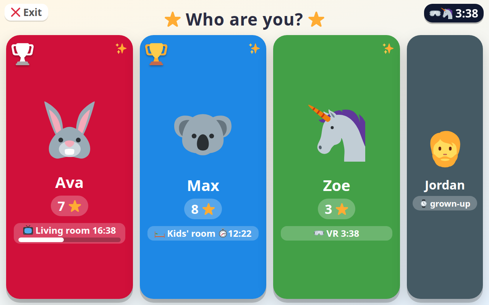
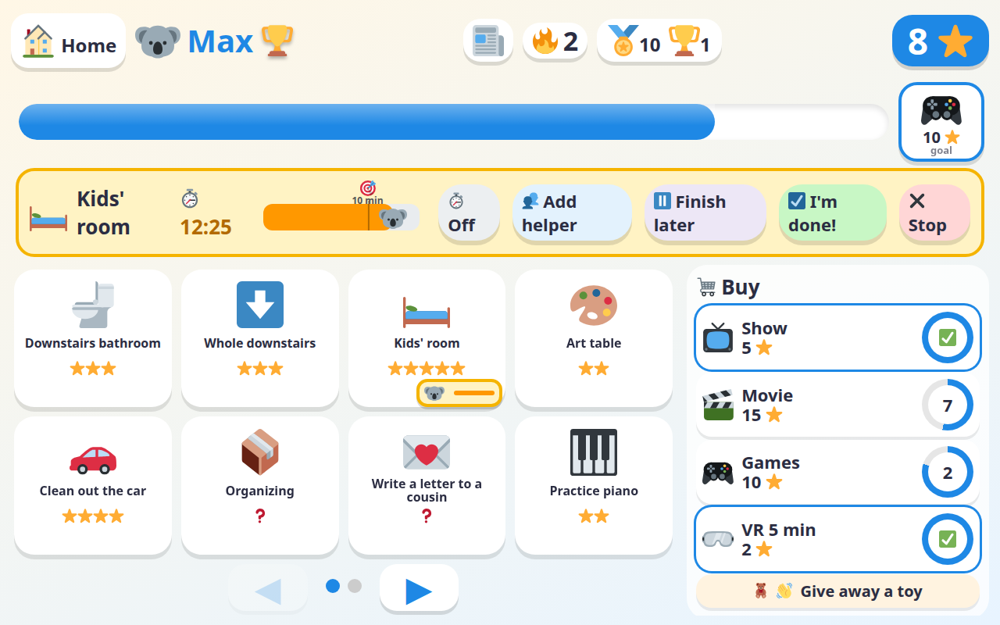
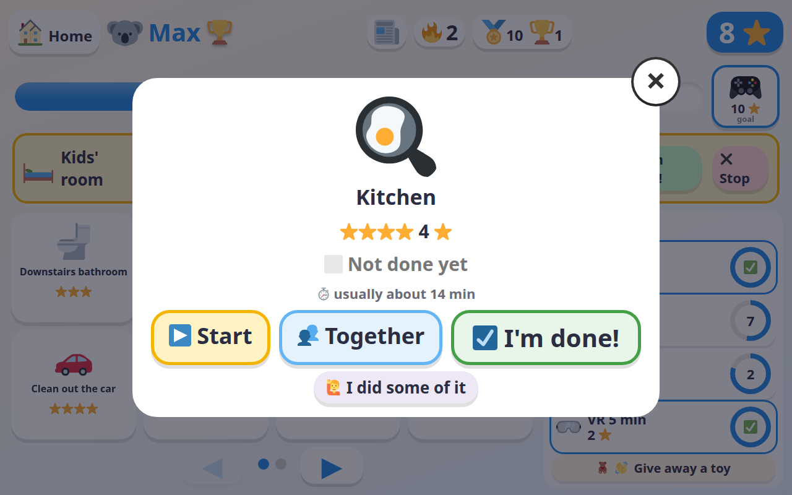
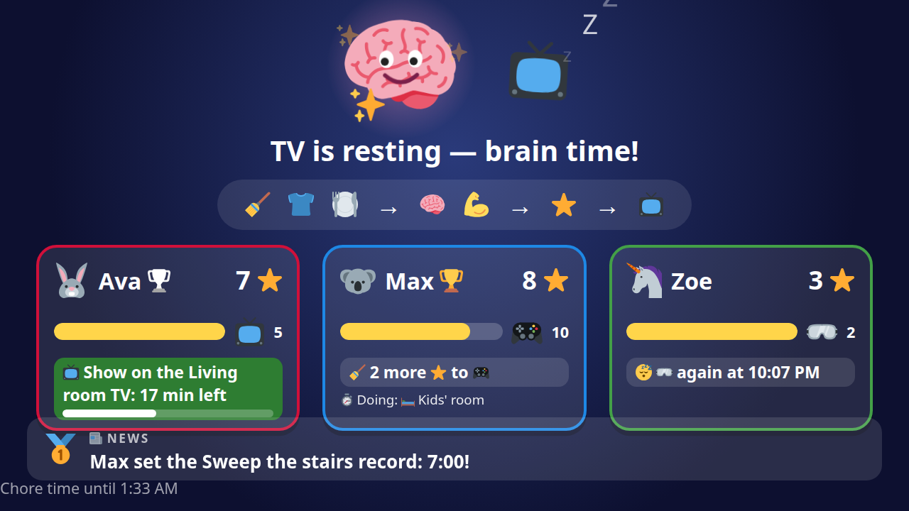
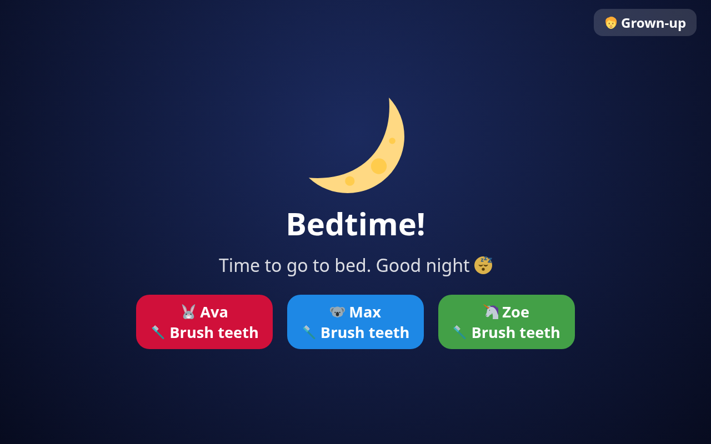
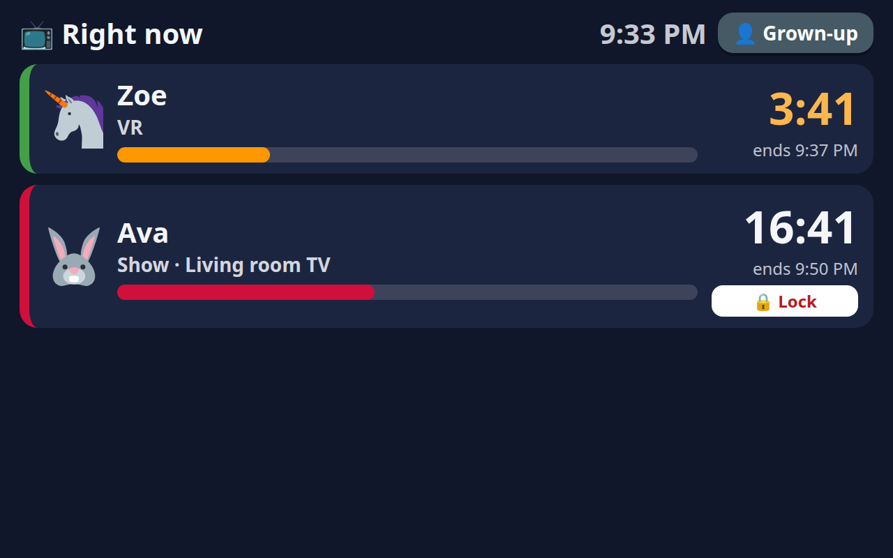
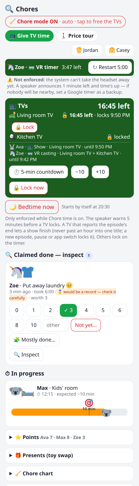

<div align="center">

# ⭐ Chore Time

**A chore chart that actually runs the house.**
Kids pick jobs on a touch screen, a grown-up checks the work from their watch,
and the TV unlocks when the stars are earned.


[](https://github.com/nelsonblaha/chore-time/actions/workflows/tests.yml)


</div>

---

Sticker charts stop working around the third week. Chore Time keeps working because the house plays along:

- 🧒 **Kids run it themselves** on a touch screen: pick your face, pick a job, start the timer, tap *I'm done*.
- 🔍 **Grown-ups inspect, not nag.** A notification lands on your phone and watch with one-tap *Pass +3*, *Not yet* or *0⭐*.
- 📺 **Stars buy real screen time.** The TV is locked until a kid spends stars on a show, a movie or video games. Then it unlocks, counts down, warns at five minutes, and locks again by itself.
- 💡 **The house reacts.** Lights in the room being cleaned go bright white, and a few colour bulbs glow in that kid's colour. When a room passes inspection, the robot vacuum cleans its newly clear floor the next time nobody's around.
- 🌙 **Bedtime is built in.** At bedtime the screens stop offering jobs and rewards and send everyone to bed (after brushing their teeth).

It's one small Python server with no database and no build step. It runs on a Raspberry Pi, a NAS or the box your Home Assistant lives on.

## A tour

<table>
<tr>
<td width="50%"><br>
<b>Who are you?</b> Each card shows what that kid is doing right now: a show counting down, a job in progress with its timer, VR time left.</td>
<td width="50%"><br>
<b>A kid's screen.</b> The job in progress races a "usual time" marker. Stars grow toward a chosen goal. Clean rooms disappear from the list until they need doing again.</td>
</tr>
<tr>
<td><br>
<b>Start, team up, or say it's done.</b> Teams split the stars. <i>I did some of it</i> lets a grown-up pay for part of the job and leaves the rest for someone else.</td>
<td><br>
<b>The TV lock screen.</b> A locked TV shows everyone's progress toward their next reward, who's watching where, and when a screen break ends.</td>
</tr>
<tr>
<td><br>
<b>Bedtime.</b> Only <i>Brush teeth</i> is left. It goes 🪥 → 🔍 waiting for a grown-up → 🛏️ <i>Go to bed!</i>. Jobs in progress are saved for the morning.</td>
<td><br>
<b>The "Right now" board</b> for a kitchen display: every running reward with a filling bar, and a 🔒 that asks the grown-up's watch first, because kids can reach the screen too.</td>
</tr>
</table>

<p align="center"><br>
<b>The grown-ups' page</b> works in a phone browser or inside Home Assistant: inspect with one tap, see what's in progress, give or take TV time, start bedtime early.</p>

## Nest Hub Max ready

Chore Time was built around Google **Nest Hub Max** displays. A Hub on the kitchen wall or in the kids' room becomes the chore board, and it still works as a normal Google Home device.

| | |
|---|---|
| **Cast and kept there** | During chore hours a keeper casts the kid screen to each Hub (via [catt](https://github.com/skorokithakis/catt) + DashCast) and puts it back if something replaces it. |
| **Spotify wins** | If a Hub is playing music or video, the keeper waits. The moment playback stops, the chore screen is back within about 10 seconds. A pause gets 2 minutes' grace. |
| **❌ Exit** | Kids can tap *Exit* to get plain Google Home back. Start something within 3 minutes and the Hub stays theirs until it stops. |
| **On-demand button** | A Home Assistant button per Hub ("chore board") casts the screen instantly. Repeated taps while it loads count once, so a Hub is never re-cast to death. |
| **Grown-up login by watch** | Tap the grown-up card and *"It's me"* appears on your phone and watch. One tap opens the parents' page on that Hub. It survives page reloads. |
| **Touch-sized everything** | 1280×800 layouts, big emoji tiles, and pictures over words for kids who are still learning to read. |
| **Self-updating** | Every Hub and TV page reloads itself when you deploy a new version, but never while a dialog is open. |

## Try it in one minute

```bash
git clone https://github.com/nelsonblaha/chore-time && cd chore-time
python3 tools/demo.py
```

Open **http://localhost:8790**. It's a made-up family (Ava, Max and Zoe, with grown-ups Jordan and Casey) partway through an afternoon. Also try `/inspect` (grown-ups), `/tv` (the lock screen) and `/now` (the board). No Home Assistant needed.

## Features

**Jobs that fit real kids**
- Rooms stay "clean" for a set time (3 days by default, a week for the stairs) unless a grown-up reopens them with a note ("toys under the couch").
- **Messy?** Raise a room's price for next time. Partly done? Pay for the part and keep the rest open.
- **Per-kid jobs.** *Brush teeth* once a day each (from 7:30 PM). *Shower* every other night each. *Something else* lets a kid propose their own good deed (grown-ups settle it, 0⭐ in one tap).
- **Claim a slot.** One kid per weekly lesson or event, claimed ahead of time.
- **Smart availability.** Daylight-only jobs (clean out the car), one-time jobs, date-limited jobs, and prices for a single day.
- **Bundles** like *Whole downstairs*, priced as the sum of the rooms still dirty, with a bonus once there are three or more.
- **Propose a price.** For open-ended jobs ("write a letter"), the kid suggests a number of stars.

**Fun that keeps them coming back**
- Tiered achievements (bronze → diamond), personal bests and house records per job, streaks that skip days a kid was away, a news ticker ("Max set the Sweep the stairs record: 7:00!").
- A presents stash for trading old toys, and a "give away a toy" flow.

**Screen time, enforced**
- TV rewards unlock a specific TV, or every TV. The clock starts when the kid actually starts watching, and back-to-back purchases queue.
- **Watching together:** everyone watching pays, and they share one clock (being honest about it is part of the design).
- **Screen breaks:** two shows in a row, or a movie or games, earn a one-hour break.
- **Finish the show:** on TVs that report playback position (e.g. Plex), time running out mid-episode lets that episode finish, plus 5 minutes. Never more than an hour into one title. Autoplay into the next episode locks it.
- Supports **Sony / Google TV** (including the console on HDMI), **Vizio** SmartCast, and anything Chromecast.

**The house plays along** *(Home Assistant)*
- Bright white light and open shades in the room being cleaned. Selected colour bulbs show the working kid's colour (one kid asked for their colour plus a "family purple" pair, so that's a setting).
- A room waiting for inspection glows in the inspecting grown-up's colour.
- **Vacuum autopilot** with goals: the kitchen every night, the dining room on nights dinner was eaten there (judged from its motion sensor), every other room at least every 3 days, and any room right after its tidy passes (the floor is clear). Any robot run, even one started by a room's button, resets that room's clock. It only goes once the floor has been empty for 20 minutes. Quiet suction and a muted robot voice at night. It pauses for a *person* coming onto the floor (a door opening, the stairs, or walking through rooms), not for the robot setting off its own sensors. It docks if the person stays.
- An optional **Grocy** integration uses Grocy as the master chore list, with chore completions written back.

## Install for your house

1. **Get the code** and copy the example config to your data folder:
   ```bash
   git clone https://github.com/nelsonblaha/chore-time && cd chore-time
   mkdir -p ~/.local/share/chore-time
   cp example-config/chores.json example-config/house.json ~/.local/share/chore-time/
   ```
2. **Edit `chores.json`:** your kids (name, colour, emoji), grown-ups, jobs and rewards. Delete what you don't use.
3. **Edit `house.json`**, or delete it to run with no smart-home features at all. Each section turns on a module: `home_assistant`, `adults`, `tvs`, `hubs`, `launchers`, `lights`, `vacuum`, `grocy`. See [docs/configuration.md](docs/configuration.md).
4. **Run it:**
   ```bash
   python3 server.py                      # core only: standard library, nothing to install
   pip install websockets catt            # for watch buttons and Hub/TV casting
   ```
   There's a systemd unit in [docs/install.md](docs/install.md).
5. Put **`http://<server>:8790/`** on a tablet or Hub for the kids, and **`/inspect`** on your phone. Add it to Home Assistant as an iframe dashboard with `tools/ha_iframe_view.py`.

## How it works

- **One file of state:** an append-only `ledger.jsonl`. Every start, report, inspection, purchase and adjustment is an event, and everything you see is recomputed from it. Undo is just another event, and history is never lost.
- **One server:** `server.py` (Python standard library) serves the pages and a small JSON API. Optional modules start only when `house.json` configures them.
- **No build step:** the pages are plain HTML and JavaScript, emoji are [Twemoji](https://github.com/jdecked/twemoji), and casting goes through DashCast.
- **Tested against real life:** every test in [`tests/`](tests) comes from something that went wrong in a real family. For example: a personal job vanished because a sibling's report was waiting for inspection, a console on HDMI never locked because the lock page kept running in the background, and a bedtime rule paused a kid mid-toothbrush.

```bash
python3 -m unittest discover -s tests      # ~40 tests, ~15 s, no network
node tools/smoke.js                        # renders every page against a running server
```

## Contributing

Issues and pull requests are welcome. This is a family project shared in the hope it's useful, so support is best-effort. If you get it running in your house, a screenshot in an issue would make our day.

## License

[MIT](LICENSE)
